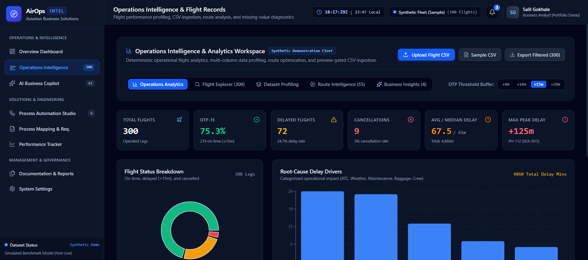
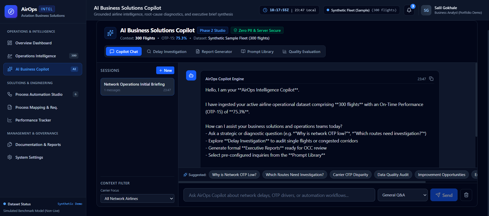
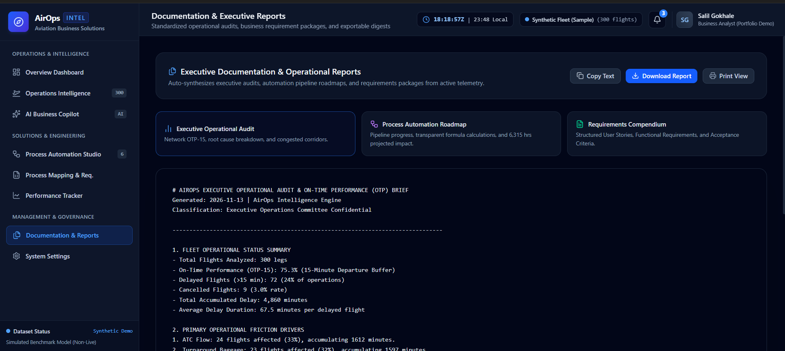

# AirOps Intelligence — Airline Operations Analytics Dashboard

A portfolio project that turns flight delay data into clear on-time performance numbers, delay-reason breakdowns, and automation ideas with an ROI estimate.

> **Portfolio prototype.** All data in this app is **synthetic sample data** (300 made-up flights). It is not connected to any real airline system, and the savings figures are formula-based estimates, not measured results.



## The problem

Airline delay data usually sits in separate files and systems, so it is hard to answer simple questions in one place: How punctual are we? Which routes are the worst? What is causing the delays? Which manual tasks are worth automating?

## What the app does

| Workspace | What you can do |
| :--- | :--- |
| **Overview Dashboard** | See the main KPIs at a glance: on-time performance, delay rate, cancellation rate, average delay. |
| **Operations Intelligence** | Upload a flight CSV, check data quality (missing values, duplicates), and explore delays by route, airline, hour and reason. |
| **AI Business Copilot** | Ask questions in plain English. The AI (Google Gemini) only explains numbers the app has already calculated. |
| **Process Automation Studio** | Review 6 automation ideas, simulate each workflow step by step, and calculate ROI and payback period. |
| **Process Mapping & Requirements** | Business problems, as-is vs to-be process diagrams, requirements, user stories and test cases. |
| **Performance Tracker** | Track each solution idea by stage and keep estimated benefits separate from demonstrated ones. |
| **Documentation & Reports** | Generate and download summary reports from the current data. |

## A closer look

### AI Business Copilot



A chat screen for asking questions about the flight data in plain English, for example "Why is network OTP low?" or "Which routes need investigation?". The Copilot starts with the numbers the app has already calculated (300 flights, 75.3% on-time performance) and explains them; it does not calculate anything itself. Suggested questions, a prompt library and an airline filter make it quick to use, and separate tabs cover delay investigation, report writing and answer quality checks.

### Documentation & Reports



This screen turns the current data into ready-to-share reports. There are three report types: an operational summary (on-time performance, delay reasons and the most delayed routes), an automation roadmap (the 6 ideas with their formula-based 6,315 hours estimate), and a requirements pack (user stories, requirements and acceptance criteria). Each report can be copied, downloaded or printed.

## Key numbers from the sample data

| Metric | Value |
| :--- | :--- |
| Flights | 300 (7 days, 4 airlines) |
| On-time performance (OTP-15) | 75.3% |
| Delay rate | 24.7% of operated flights |
| Cancellation rate | 3.0% |
| Average delay | 67.5 minutes per delayed flight |
| Top delay reasons | ATC Flow 33%, Turnaround Baggage 32%, Weather 18% |
| Estimated time saved by 6 automation ideas | 6,315 staff hours per year |

## How the numbers are calculated

- A flight is **delayed** if it departs more than 15 minutes late (the threshold can be changed to 0, 10 or 20 minutes).
- **On-time performance** = on-time flights ÷ operated flights. Cancelled flights are not counted as operated.
- **Delay rate** = delayed flights ÷ operated flights, so on-time % + delay % = 100%.
- **Delay reasons** are counted only for delayed flights, so the percentages add up to 100%.
- **Estimated hours saved** for each idea = minutes per task × tasks per week × 52 ÷ 60 × share of the task that can be automated.

All KPIs are calculated by normal code, not by AI, so the same file always gives the same result. If a file has no delay reason column, the app says so instead of guessing.

## Using your own data

1. Open **Operations Intelligence** and click **Sample CSV** to download the template.
2. Fill it with your flight data and save it as `.csv` (Excel files must be saved as CSV first).
3. Click **Upload Flight CSV**. The app checks the file and then updates every chart.

Required columns: `flight_id`, `origin`, `destination`.
Needed for KPIs: `airline`, `scheduled_departure`, `actual_departure`, `delay_minutes`, `flight_status`, `date`.
Optional: `delay_reason`, `distance`, `aircraft_type`, `passenger_load`.

## Run it locally

Requires Node.js 22 or newer.

```bash
git clone https://github.com/Salil360-cyber/airops-intelligence.git
cd airops-intelligence
npm install
cp .env.example .env    # then put your Gemini API key in .env
npm run dev
```

Open `http://localhost:3000`. Without an API key every dashboard still works; only the AI Copilot needs the key.

```bash
npm run lint    # type check
npm test        # 34 automated checks on the KPI, CSV and ROI logic
npm run build   # production build
```

A `Dockerfile` is included but has not been build-tested yet.

## Built with

- **Google AI Studio** — used to generate and iterate on the app
- **React, TypeScript, Tailwind CSS, Recharts** — interface and charts
- **Node.js + Express** — small server that keeps the Gemini API key out of the browser
- **Google Gemini API** — AI Copilot answers

## How this project was built

The app was generated with Google AI Studio and then audited before publishing: every KPI was recalculated independently, the code was compared with the documentation, and the mismatches were fixed. Examples of issues found and fixed:

- Delay-reason percentages added up to 111% because cancelled flights were counted in the numerator but not the denominator.
- The delay-rate card and the on-time KPI used two different denominators.
- Insight text stated causes that were not in the data.
- The sample data covered only one day, so it was extended to 7 days and 300 flights.

## Limitations

- Sample data only; no live airline feeds.
- No login or user roles; data is stored in the browser (`localStorage`) on one device.
- Savings figures are estimates from assumed inputs.

More detail is in [`docs/`](./docs), starting with [`docs/KNOWN_LIMITATIONS.md`](./docs/KNOWN_LIMITATIONS.md).

## Author

**Salil Gokhale** — Business Analyst / MIS (portfolio project)
[GitHub](https://github.com/Salil360-cyber)

No licence has been chosen yet; all rights reserved.
