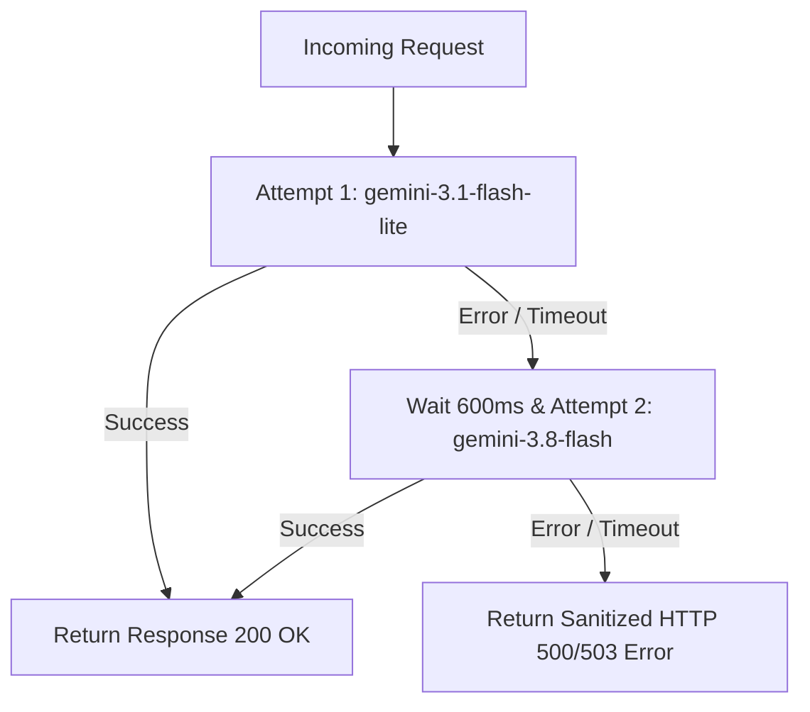

# AirOps Intelligence — AI Governance & Responsible AI Framework

This document outlines the ethical, operational, and architectural governance principles governing generative AI in AirOps Intelligence.

---

## 1. Core Principles of Enterprise Operational AI

Aviation decision-making carries zero tolerance for fabricated facts, hallucinated aircraft turn times, or unverified disruption recommendations. The AirOps Intelligence AI Copilot is governed by five non-negotiable architectural mandates:

```
┌────────────────────────────────────────────────────────────────────────┐
│                   AI ETHICAL & OPERATIONAL MANDATES                    │
├────────────────────────────────┬───────────────────────────────────────┤
│ 1. Quantitative Segregation    │ Calculations run in TypeScript engine;│
│                                │ Gemini NEVER computes core metrics.   │
├────────────────────────────────┼───────────────────────────────────────┤
│ 2. Missing Data Transparency   │ If cause telemetry is absent, Gemini  │
│                                │ MUST state it; no guessing causes.    │
├────────────────────────────────┼───────────────────────────────────────┤
│ 3. Constitutional Formatting   │ Mandatory four-section response:      │
│                                │ FACT, INTERPRETATION, REC, NEXT STEPS │
├────────────────────────────────┼───────────────────────────────────────┤
│ 4. Human-in-the-Loop           │ Mandatory OCC leadership sign-off;    │
│                                │ zero autonomous dispatch execution.   │
├────────────────────────────────┼───────────────────────────────────────┤
│ 5. PII & Secret Isolation      │ Zero passenger PII in prompts;        │
│                                │ API keys isolated server-side.        │
└────────────────────────────────┴───────────────────────────────────────┘
```

---

## 2. Mandatory Constitutional Response Structure

Whenever the AI Copilot responds in diagnostic, operational, or strategic modes, it must format its output into four distinct sections:

### 1. `[CALCULATED FACT]`
- **Definition:** Exact numerical metrics extracted directly from the analytics engine context (e.g. flight counts, OTP-15 percentage, average delay duration, verified cancellation rate).
- **Enforcement:** The model is forbidden from inventing or extrapolating statistical figures not explicitly present in the operational payload.

### 2. `[OPERATIONAL INTERPRETATION]`
- **Definition:** Business and turnaround implications (e.g. minimum connect time erosion, flight crew duty period limits, turnaround ground buffer consumption).
- **Enforcement:** Must be framed strictly based on recorded events without asserting unverified external causes.

### 3. `[RECOMMENDATION]`
- **Definition:** Pragmatic, actionable recommendations (e.g. deploying automated SMS re-accommodation, prioritizing widebody gate hold reconciliation, implementing scheduled ETL delivery).
- **Enforcement:** Must state that recommendations are advisory and require human operational review.

### 4. `[NEXT INVESTIGATION]`
- **Definition:** Specific operational records, telematics, or cross-system audits required to confirm the hypothesis before taking real-world action (e.g. flight movement logs, passenger rebooking queue, maintenance parts logs, airspace advisories).

---

## 3. Server-Side Prompt Sanitization & System Instruction

The backend (`server.ts`) constructs sanitized prompts containing only aggregated operational statistics:

```typescript
const systemInstruction = `You are the AirOps Intelligence AI Business Solutions Copilot for an enterprise airline operations and business solutions team.

STRICT OPERATIONAL, FACTUAL & ETHICAL CONSTITUTION:
1. QUANTITATIVE INTEGRITY: Base all numerical assertions strictly on the provided operational context metrics. NEVER invent flight counts, delay durations, percentages, or synthetic statistics.
2. MISSING DATA TRANSPARENCY: If categorized delay cause telemetry (e.g. categorized delay reasons) is absent from the dataset (context.hasDelayCauses === false), you MUST explicitly state: "Delay root-cause telemetry is not available in the active dataset." DO NOT guess or synthesize causes like weather or ATC unless explicitly confirmed in the data context.
3. STRUCTURED BUSINESS RESPONSE: When answering operational, diagnostic, or strategic inquiries, structure your response using the following four mandatory sections:
   [CALCULATED FACT]
   [OPERATIONAL INTERPRETATION]
   [RECOMMENDATION]
   [NEXT INVESTIGATION]
4. RESPONSIBLE AI & HUMAN GOVERNANCE:
   - Recommendations must clearly state that human review and operational validation by OCC leadership is mandatory prior to operational execution.
   - You must NOT make automatic dispatch decisions.
   - Never output passenger personal information (PII).
5. TERMINOLOGY & FORMATTING:
   - Use clear airline business-analyst terminology (OTP-15, block time, ground turnaround, departure slot compliance, minimum connect time, load factor).`;
```

---

## 4. Multi-Tier Model Fallback Strategy

To ensure high availability and prevent single-point-of-failure errors during peak loads, `server.ts` implements an automated retry cascade across candidate models:



---

## 5. Security & Privacy Boundary

- **No Client-Side Credentials:** The frontend bundle has no knowledge of Google Cloud or Gemini credentials.
- **No Training on User Telemetry:** The `@google/genai` calls do not store user prompts for training.
- **PII Scrubbing:** Operational context contains only operational identifiers (`flight_id`, `route`, `equipment_type`, `delay_minutes`). Passenger names, emails, credit card numbers, and passport details are never passed to the model.
