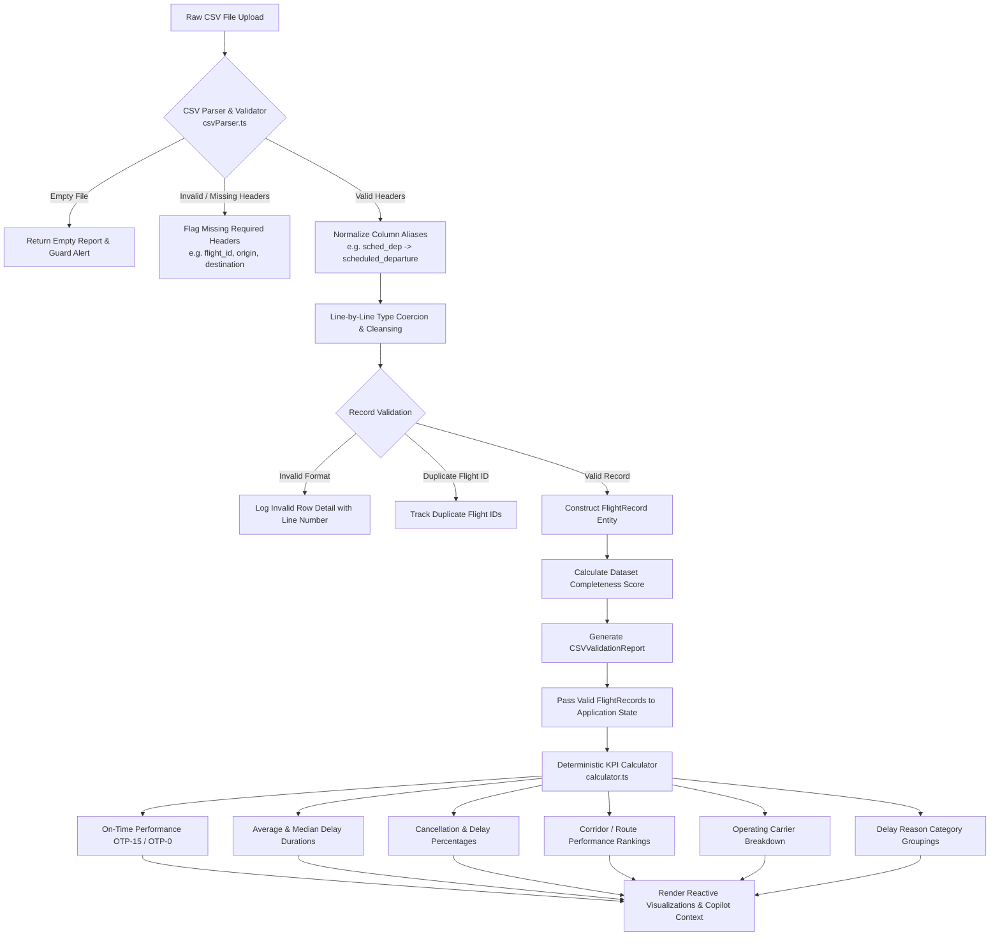
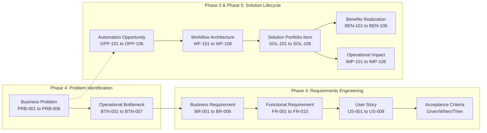
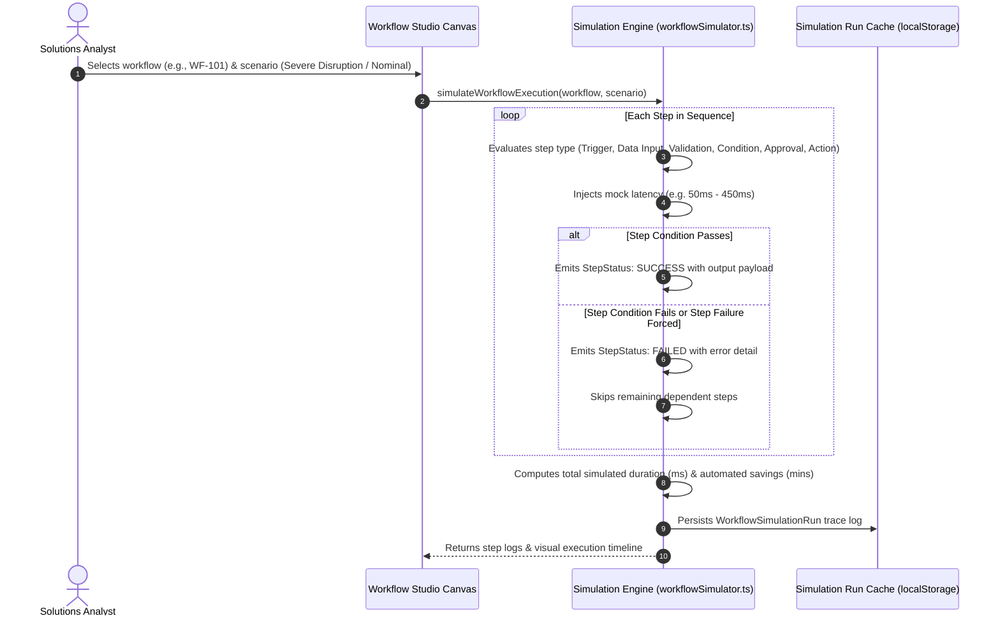

# AirOps Intelligence — Data Flow & Ingestion Pipeline

This document explains the data lifecycle, data transformation pipelines, and event propagation flows across AirOps Intelligence.

---

## 1. Operational Analytics & CSV Ingestion Pipeline



### Ingestion Validation Rules
1. **Header Alias Resolution:** Supports varying naming conventions from disparate legacy feeds (e.g. `carrier`, `airline_name`, `operator` normalize to `airline`; `sched_dep`, `std`, `sched_departure_time` normalize to `scheduled_departure`).
2. **Duplicate Detection:** Scans for multiple flights sharing identical `flight_id` on the same date and flags them in the validation drawer.
3. **Data Completeness Index:** Calculates the ratio of populated non-null fields across distance, equipment type, passenger load, and delay causes to provide a transparency score (0–100%).
4. **Resilient Row Skipping:** Corrupted rows are isolated with their line numbers and error reasons; valid rows are parsed and presented without terminating ingestion.

---

## 2. Requirements Engineering Traceability Flow



---

## 3. Workflow Simulation Data Flow

The workflow simulation engine (`src/utils/workflowSimulator.ts`) executes in-browser:



---

## 4. Audit Trail Event Propagation Flow

```mermaid
sequenceDiagram
    autonumber
    actor User as User / Auditor
    participant Component as Module UI Component
    participant Logger as Client Audit Logger (auditLogger.ts)
    participant Storage as Browser LocalStorage
    participant Backend as Express Server (/api/audit-events)

    User->>Component: Performs mutating action (Create PRB, Edit WF, Reclassify SOL)
    Component->>Logger: recordAuditEvent({ entityType, entityId, action, previousValue, newValue, notes })
    Logger->>Logger: Generates unique Audit ID (e.g. AUD-009) & UTC Timestamp
    Logger->>Storage: Writes updated event array to 'airops_audit_trail_events'
    Note over Logger,Storage: Intercepts QuotaExceededError and trims older entries if storage is full
    Logger->)Backend: POST /api/audit-events (asynchronous HTTP background notification)
    Backend->>Backend: Appends event to in-memory server audit ledger
    Logger-->>Component: Returns recorded AuditEvent entity
```
