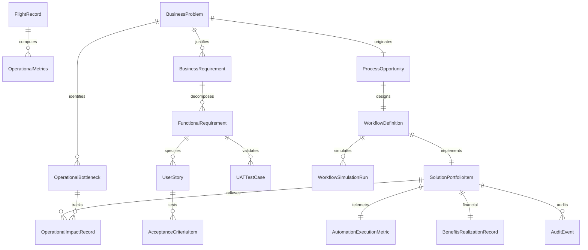

# AirOps Intelligence — Data Models & Schema Reference

This document provides the complete schema reference for all primary data models and TypeScript entities in AirOps Intelligence (`src/types.ts`).

---

## 1. Relational Entity-Relationship Diagram



---

## 2. Operations Intelligence Entities (Phase 1)

### `FlightRecord`
Represents an individual scheduled flight operation with scheduled, actual, delay, and reason metadata:
```typescript
interface FlightRecord {
  flight_id: string;               // e.g. "SK-101"
  airline: string;                 // Operating carrier, e.g. "SkyStream Airlines"
  origin: string;                  // 3-letter airport origin code, e.g. "JFK"
  destination: string;             // 3-letter airport destination code, e.g. "LHR"
  scheduled_departure: string;     // HH:mm 24-hr format, e.g. "08:00"
  actual_departure: string;        // HH:mm 24-hr format, e.g. "08:05"
  delay_minutes: number;           // Non-negative integer (or 0 for on-time/early)
  flight_status: 'ON_TIME' | 'DELAYED' | 'CANCELLED';
  distance?: number;               // Nautical miles or statute miles
  date?: string;                   // YYYY-MM-DD
  delay_reason?: string;           // e.g. "ATC Flow", "Ground Turnaround", "Weather"
  aircraft_type?: string;          // e.g. "B787-9", "A321neo"
  passenger_load?: number;         // Booked passenger count
}
```

### `OperationalMetrics`
Aggregated fleet performance indicators deterministically calculated from flight records:
```typescript
interface OperationalMetrics {
  totalFlights: number;
  onTimeFlights: number;
  delayedFlights: number;
  cancelledFlights: number;
  onTimePerformance: number;       // Percentage (0.0 - 100.0)
  averageDelayMinutes: number;     // Average delay among delayed flights
  medianDelayMinutes: number;      // Median delay among delayed flights
  cancellationRate: number;        // Percentage
  topDelayCauses: { cause: string; count: number; percentage: number }[];
  routePerformance: RoutePerformance[];
  airlineBreakdown: AirlineBreakdown[];
}
```

---

## 3. Automation Studio Entities (Phase 3)

### `ProcessOpportunity`
Represents an identified manual friction point evaluated for digital automation:
```typescript
interface ProcessOpportunity {
  id: string;                      // e.g. "OPP-101"
  title: string;
  department: string;              // "Customer Experience", "OCC & Dispatch", etc.
  manualTaskDescription: string;
  repetitiveActivities: string;
  frequencyPerWeek: number;
  timeSpentPerTaskMinutes: number;
  peopleInvolved: number;
  complexity: 'Low' | 'Medium' | 'High';
  priority: 'Low' | 'Medium' | 'High' | 'Critical';
  businessOwner: string;
  dependencies: string[];
  riskNotes: string;
  bottlenecks: string[];
  expectedBenefits: string[];
  humanIntervention: string;
  automationFeasibility: 'Low' | 'Medium' | 'High';
  proposedSolution: string;
  solutionType: 'RPA' | 'Direct API Integration' | 'Low-Code App' | 'Event Webhook & Alerting';
  estimatedHoursSavedAnnual: number;
  measuredHoursSavedAnnual: number;
  status: 'Identified' | 'Under Review' | 'Approved' | 'In Progress' | 'Implemented';
  manualWorkflowSteps: string[];
  proposedWorkflowSteps: string[];
  createdAt: string;
  updatedAt: string;
}
```

### `WorkflowDefinition`
Structural low-code automation workflow specification:
```typescript
interface WorkflowDefinition {
  id: string;                      // e.g. "WF-101"
  processId: string;               // Links to OPP-101
  name: string;
  description: string;
  department: string;
  status: 'Draft' | 'Active' | 'Paused' | 'Archived';
  steps: WorkflowStep[];
  createdAt: string;
  updatedAt: string;
}

interface WorkflowStep {
  id: string;                      // e.g. "s-101-1"
  name: string;
  type: 'Trigger' | 'Data Input' | 'Validation' | 'Condition' | 'Approval' | 'Action' | 'Notification' | 'Data Transformation' | 'End';
  description: string;
  config: Record<string, any>;
  nextStepId?: string;
}
```

---

## 4. Requirements Engineering Entities (Phase 4)

### `BusinessProblem` & `OperationalBottleneck`
```typescript
interface BusinessProblem {
  id: string;                      // e.g. "PRB-001"
  title: string;
  department: string;
  description: string;
  businessImpact: string;
  affectedRoles: string[];
  severity: 'Low' | 'Medium' | 'High' | 'Critical';
  status: 'Open' | 'In Analysis' | 'Solution Designed' | 'Closed';
  linkedOpportunityId?: string;    // Links to OPP-101
  createdAt: string;
}

interface OperationalBottleneck {
  id: string;                      // e.g. "BTN-001"
  problemId: string;               // Links to PRB-001
  title: string;
  category: 'Manual Handoff' | 'Repeated Data Entry' | 'Processing Delay' | 'Approval Bottleneck' | 'Data Quality Issue' | 'Missing Integration';
  impactDescription: string;
  estimatedDelayMinutes: number;
  linkedOpportunityId?: string;
  severity: 'Low' | 'Medium' | 'High' | 'Critical';
  mitigationStrategy: string;
}
```

### Traceability Hierarchy (`BR`, `FR`, `US`, `UAT`)
```typescript
interface BusinessRequirement {
  id: string;                      // e.g. "BR-001"
  problemId: string;               // Links to PRB-001
  title: string;
  description: string;
  businessRationale: string;
  stakeholder: string;
  priority: 'Must Have' | 'Should Have' | 'Could Have' | "Won't Have";
  dependencies: string[];
  status: 'Draft' | 'Approved' | 'In Development' | 'Verified';
  createdAt: string;
}

interface FunctionalRequirement {
  id: string;                      // e.g. "FR-001"
  businessReqId: string;           // Links to BR-001
  title: string;
  systemBehavior: string;
  trigger: string;
  inputs: string[];
  expectedOutputs: string[];
  validationRules: string[];
  errorHandling: string;
  dependencies: string[];
  priority: 'Must Have' | 'Should Have' | 'Could Have' | "Won't Have";
  status: 'Draft' | 'Approved' | 'In Development' | 'Verified';
}

interface UserStory {
  id: string;                      // e.g. "US-001"
  problemId: string;               // Links to PRB-001
  functionalReqId?: string;        // Links to FR-001
  role: string;                    // e.g. "Flight Dispatcher"
  want: string;
  benefit: string;
  priority: 'Must Have' | 'Should Have' | 'Could Have' | "Won't Have";
  dependencies: string[];
  status: 'Draft' | 'Ready for Dev' | 'In Progress' | 'Implemented';
}
```

---

## 5. Solutions Performance Tracker Entities (Phase 5)

### `SolutionPortfolioItem`
```typescript
interface SolutionPortfolioItem {
  id: string;                      // e.g. "SOL-101"
  opportunityId: string;           // Links to OPP-101
  problemId: string;               // Links to PRB-001
  bottleneckId?: string;           // Links to BTN-001
  requirementIds: string[];        // ["BR-001", "FR-001"]
  userStoryIds: string[];          // ["US-001", "US-002"]
  solutionTitle: string;
  department: string;
  solutionOwner: string;
  priority: 'Low' | 'Medium' | 'High' | 'Critical';
  status: 'Identified' | 'Under Review' | 'Approved' | 'In Progress' | 'Implemented';
  stage: 'Discovery' | 'Architecture' | 'Build' | 'Testing' | 'Production';
  plannedCompletionDate: string;
  actualCompletionDate?: string;
  targetBenefitHours: number;
  measuredBenefitHours: number;
  targetMetric: string;
  latestResult: string;
  benefitTier: 'Estimated' | 'Simulated' | 'Demonstration Benchmark' | 'Measured';
}
```

### `AutomationExecutionMetric` & `BenefitsRealizationRecord`
```typescript
interface AutomationExecutionMetric {
  workflowId: string;              // e.g. "WF-104"
  workflowName: string;
  environment: 'Local Simulation' | 'Demonstration Benchmark' | 'Production Measured';
  totalRuns: number;
  successfulRuns: number;
  failedRuns: number;
  blockedRuns: number;
  avgDurationMs: number;
  manualTimeMinutes: number;
  automatedTimeSeconds: number;
  timeSavedPerRunMinutes: number;
  totalTimeSavedHours: number;
  successRate: number;
  lastExecution: string;
}

interface BenefitsRealizationRecord {
  id: string;                      // e.g. "BEN-104"
  solutionId: string;              // Links to SOL-104
  solutionTitle: string;
  department: string;
  approvedBusinessCase: string;
  baselineManualMinutes: number;
  actualObservedMinutes: number;
  annualExecutionVolume: number;
  implementationCostUSD: number;
  annualRecurringMaintenanceUSD: number;
  laborHourlyRateUSD: number;
  estimatedAnnualLaborValueUSD: number;
  actualMeasuredLaborValueUSD: number;
  firstYearNetBenefitUSD: number;
  roiPercentage: number;
  paybackPeriodMonths: number;
  valueType: 'Estimated' | 'Simulated' | 'Demonstration Benchmark' | 'Measured';
  evidenceDescription: string;
  verifiedBy: string;
  verifiedDate: string;
}
```

---

## 6. Audit Trail Entity (Phase 6)

```typescript
interface AuditEvent {
  id: string;                      // e.g. "AUD-001"
  timestamp: string;               // ISO 8601 UTC
  entityType: 'Business Problem' | 'Automation Opportunity' | 'Workflow' | 'Requirement' | 'UAT Test' | 'KPI Policy' | 'Benefits Realization' | 'Operational Telemetry' | 'Evidence Classification' | 'System Backup';
  entityId: string;                // Primary Key of target entity
  action: 'CREATE' | 'UPDATE' | 'DELETE' | 'EXECUTE' | 'SIMULATE' | 'RECLASSIFY' | 'EXPORT' | 'RESTORE' | 'RESET';
  actor: string;                   // User / system identity
  previousValue?: string | null;
  newValue?: string | null;
  notes?: string;
  environment: 'Local Prototype Record';
}
```
