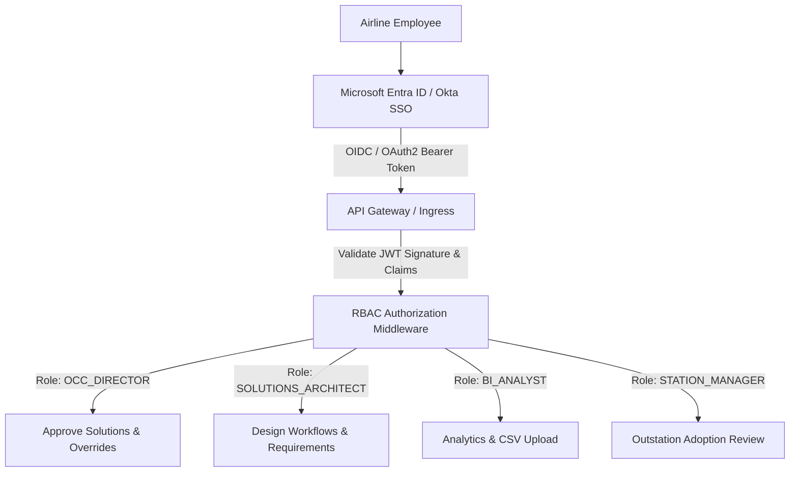

# AirOps Intelligence — Security Review & Threat Assessment

This document provides a comprehensive security review of the AirOps Intelligence codebase, identifying defensive controls, current prototype boundaries, and production security migration paths.

---

## 1. Threat Modeling & Defensive Controls Summary

| Threat / Risk Vector | Severity | Remediation Implemented in AirOps Intelligence | Verification |
| :--- | :---: | :--- | :---: |
| **API Secret Exposure** | **High** | Gemini API keys are never bundled into client JavaScript. All AI requests pass through the backend proxy (`POST /api/gemini/copilot`). | **PASS** |
| **API Denial-of-Service / Abuse** | **Medium** | In-memory token bucket rate limiter restricts AI queries to 30 requests per minute per IP, returning HTTP 429 with `Retry-After`. | **PASS** |
| **Prompt Injection / Overflow** | **Medium** | Input length strictly capped at 8,000 characters; payload schemas validated; prompts structured with fixed server-side system instructions. | **PASS** |
| **Clickjacking & MIME-Sniffing** | **Low** | HTTP response headers enforce `X-Frame-Options: SAMEORIGIN` and `X-Content-Type-Options: nosniff`. | **PASS** |
| **Malformed Payload Crash** | **Medium** | Express JSON parsing error middleware catches invalid syntax and returns clean HTTP 400 without exposing stack traces. | **PASS** |
| **Local Storage Quota Denial** | **Low** | Storage write helpers intercept `QuotaExceededError` and apply log pruning to ensure application stability. | **PASS** |

---

## 2. Server-Side Security Headers

Configured in `server.ts` before route dispatch:

```typescript
app.use((req, res, next) => {
  res.setHeader('X-Content-Type-Options', 'nosniff');
  res.setHeader('X-Frame-Options', 'SAMEORIGIN');
  res.setHeader('X-XSS-Protection', '1; mode=block');
  res.setHeader('Referrer-Policy', 'strict-origin-when-cross-origin');
  res.setHeader('Permissions-Policy', 'camera=(), microphone=(), geolocation=()');
  next();
});
```

---

## 3. Rate Limiting & Reverse Proxy Trust Architecture

To protect the server and upstream Gemini API quota, `server.ts` enforces in-memory rate limiting and configures Express proxy trust:

```typescript
// Configure Express proxy trust for container/cloud ingress (e.g. Cloud Run, Nginx, or Docker behind 1 proxy hop)
// Avoids blind trust in arbitrary forwarded IP headers
if (process.env.TRUST_PROXY) {
  app.set('trust proxy', process.env.TRUST_PROXY === 'true' ? true : parseInt(process.env.TRUST_PROXY, 10));
} else if (process.env.NODE_ENV === 'production') {
  app.set('trust proxy', 1);
}

const aiRateLimitMap = new Map<string, RateLimitRecord>();
const RATE_LIMIT_WINDOW_MS = 60 * 1000; // 1 minute window
const RATE_LIMIT_MAX_REQUESTS = 30;     // 30 requests per window

function aiRateLimiter(req: express.Request, res: express.Response, next: express.NextFunction) {
  // Safely obtain IP: Express req.ip leverages trust proxy configuration; fallback to socket remoteAddress
  const clientIp = req.ip || req.socket.remoteAddress || '127.0.0.1';
  const now = Date.now();
  const record = aiRateLimitMap.get(clientIp);

  if (!record || now > record.resetTime) {
    aiRateLimitMap.set(clientIp, { count: 1, resetTime: now + RATE_LIMIT_WINDOW_MS });
    res.setHeader('X-RateLimit-Limit', RATE_LIMIT_MAX_REQUESTS);
    res.setHeader('X-RateLimit-Remaining', RATE_LIMIT_MAX_REQUESTS - 1);
    return next();
  }

  if (record.count >= RATE_LIMIT_MAX_REQUESTS) {
    const retryAfterSeconds = Math.ceil((record.resetTime - now) / 1000);
    res.setHeader('Retry-After', retryAfterSeconds);
    return res.status(429).json({
      error: 'AI query rate limit exceeded (30 requests/minute). Please wait before submitting another inquiry.',
      code: 'RATE_LIMIT_EXCEEDED',
      retryAfterSeconds,
    });
  }

  record.count += 1;
  res.setHeader('X-RateLimit-Limit', RATE_LIMIT_MAX_REQUESTS);
  res.setHeader('X-RateLimit-Remaining', Math.max(0, RATE_LIMIT_MAX_REQUESTS - record.count));
  next();
}
```

---

## 4. Authentication & Authorization Review

### Current Prototype Boundary
- **Single-User Architecture:** AirOps Intelligence does not implement authentication.
- **Honest Attribution:** All mutating actions are logged to the audit ledger under the actor `"Local Session (Prototype Auditor)"`. Fictitious logins or fake password fields are not used.

### Multi-User Enterprise Migration Blueprint
For deployment in an airline operating environment, the following enterprise security controls are required:



1. **Enterprise Identity Provider:** OIDC integration with Microsoft Entra ID (Azure AD) or Okta.
2. **Role-Based Access Control (RBAC):**
   - `OCC_DIRECTOR`: Full authority to approve solutions, sign off on executive reports, and advance stage gates.
   - `SOLUTIONS_ARCHITECT`: Authority to create workflows, configure step parameters, and write acceptance criteria.
   - `BI_ANALYST`: Query access, CSV ingestion, and export generation.
   - `STATION_MANAGER`: Read-only access to local station metrics and adoption telemetry.
3. **Audit Streaming:** Exporting audit events from `/api/audit-events` to centralized cloud monitoring (e.g., Google Cloud Operations) with write-once log retention. Note: The current prototype uses a local prototype audit log (browser storage, resettable).
