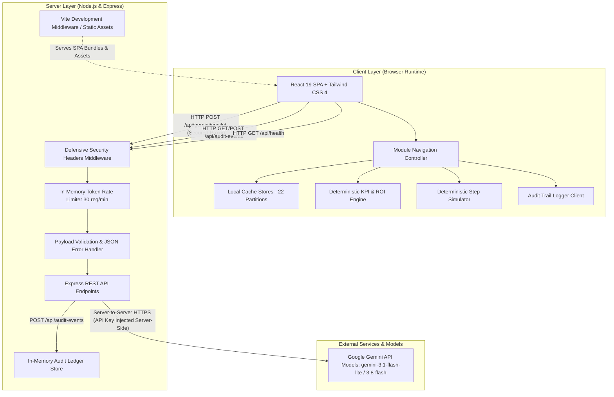
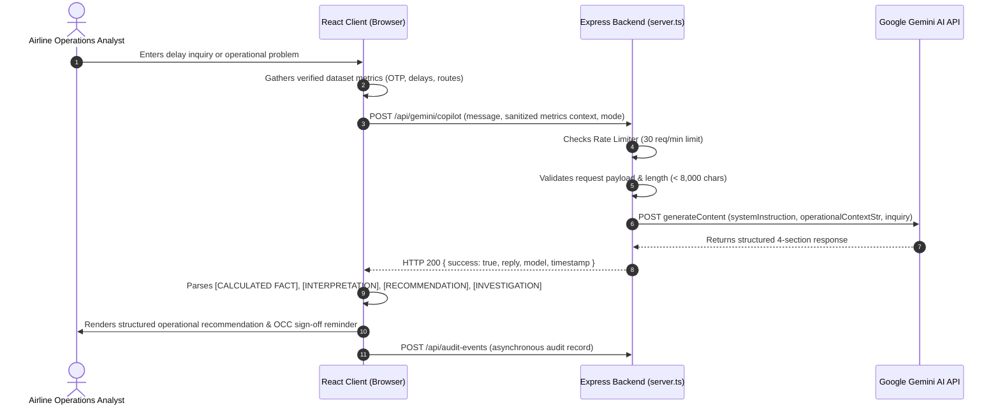

# AirOps Intelligence — System Architecture

This document describes the technical architecture, component boundaries, security enforcement, and design patterns implemented in the AirOps Intelligence platform.

---

## 1. High-Level Architectural Diagram

---

## 2. Layer Responsibilities

### Client Layer (React 19 SPA)
- **Framework & Styling:** Built with React 19, TypeScript 7, and Tailwind CSS 4 (`@import "tailwindcss";`).
- **Data Visualization:** Responsive chart rendering via Recharts with explicit zero-width min-width containers (`ResponsiveContainer`, `BarChart`, `PieChart`, `CartesianGrid`, `Tooltip`).
- **Deterministic Math:** Client-side computation of all operational metrics (`calculateOperationalMetrics`), ROI projections (`calculateAutomationROI`), and step-by-step workflow executions (`simulateWorkflowExecution`) to guarantee instantaneous feedback (< 50ms) without cloud network latency.
- **Client Persistence:** Local storage abstraction (`src/utils/storage.ts`, `src/utils/performanceStorage.ts`, `src/utils/requirementsStorage.ts`, `src/utils/workflowStorage.ts`, `src/utils/auditLogger.ts`) with quota management and full-archive backup/restore.

### Server Layer (Node.js & Express)
- **Single Process Full-Stack Model:** Express backend configured in `server.ts`. In development, Vite is mounted via `vite.middlewares` (`"dev": "tsx server.ts"`). In production, Express serves compiled static files from `dist/` with SPA fallback routing.
- **Defensive Security Headers:**
  - `X-Content-Type-Options: nosniff` (mitigates MIME-type sniffing).
  - `X-Frame-Options: SAMEORIGIN` (prevents cross-origin clickjacking).
  - `X-XSS-Protection: 1; mode=block`.
  - `Referrer-Policy: strict-origin-when-cross-origin`.
  - `Permissions-Policy: camera=(), microphone=(), geolocation=()`.
- **In-Memory Rate Limiting:** Enforces a sliding window limit of 30 requests per minute per IP on `/api/gemini/*` endpoints to protect against quota exhaustion and denial-of-service.
- **Payload Validation & Error Sanitization:** Restricts AI inquiry length to 8,000 characters and catches malformed JSON syntax errors, returning clean HTTP 400 responses without exposing internal server stack traces.

### External AI Model Integration
- **Google GenAI SDK (`@google/genai`):** Used on the server side to invoke models via modern APIs.
- **Model Fallback Cascade:** Automatically attempts `gemini-3.1-flash-lite`, with structured fallback to `gemini-3.8-flash`.
- **Zero Client-Side Secret Leakage:** The `GEMINI_API_KEY` is accessed exclusively in Node.js runtime memory (`process.env.GEMINI_API_KEY`), never bundled or passed to the browser.

---

## 3. Technology Stack Reference

| Layer | Component | Version | Purpose |
| :--- | :--- | :--- | :--- |
| **Frontend** | React | `^19.0.1` | Declarative UI and hook-driven state management |
| **Frontend** | TypeScript | `^7.0.2` | Static type safety and data model enforcement |
| **Frontend** | Tailwind CSS | `^4.3.3` | Modern, responsive dark enterprise utility styling |
| **Frontend** | Recharts | `^3.10.1` | Interactive operational and financial charts |
| **Frontend** | Lucide React | `^0.546.0` | Comprehensive enterprise iconography |
| **Frontend** | Motion | `^12.23.24` | Smooth transitions and state animations |
| **Backend** | Node.js | `>= 22.0.0` | Backend JavaScript runtime |
| **Backend** | Express | `^4.21.2` | Web API routing and middleware management |
| **Backend** | TSX | `^4.21.0` | Fast TypeScript execution for `server.ts` |
| **Backend** | Dotenv | `^17.2.3` | Environment variable parsing |
| **AI SDK** | @google/genai | `^3.1.0` | Server-side Google Gemini TypeScript integration |
| **Build Tool** | Vite | `^8.3.0` | Next-generation frontend bundler and dev middleware |

---

## 4. Architectural Boundaries & Data Flow

